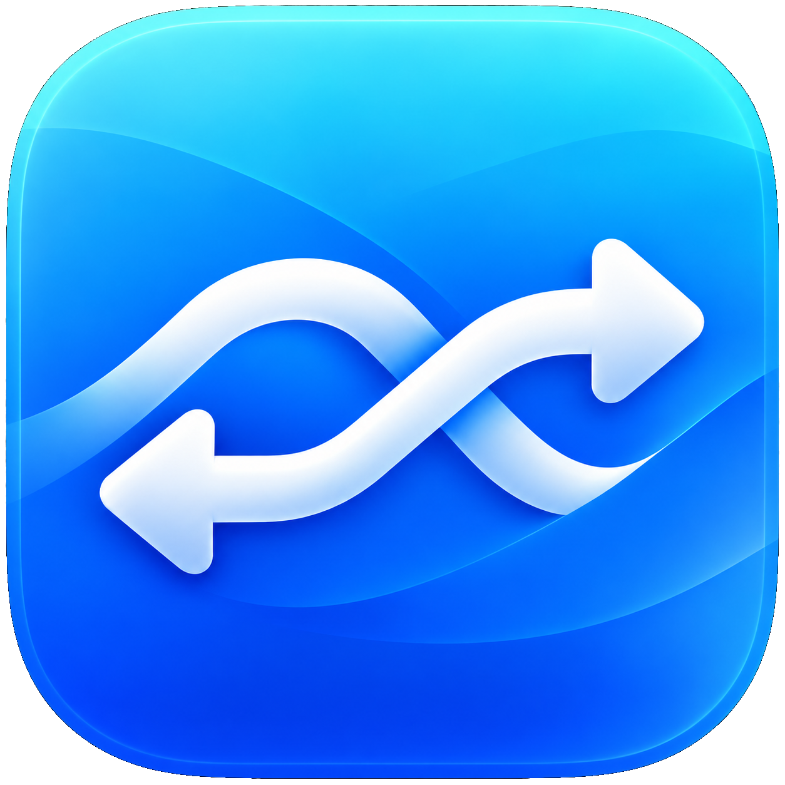

# QuickShareMac



Send files between your Mac and Android devices using **Quick Share** over your local network.

Developed by Mark Andrey · github.com/markandreydc

**QuickShareMac is a fork of [NearDrop](https://github.com/grishka/NearDrop), created by [grishka](https://github.com/grishka).** NearDrop provides the original Quick Share/Nearby Share implementation and protocol research that this app builds on. This fork adds a dedicated Send/Receive interface, transfer history, settings, and connection diagnostics.

## Features

- **Send files** from the main window, by drag-and-drop, or through Finder’s Share menu.
- **Receive files** with explicit approval and a PIN check for each transfer.
- **Connect with a QR code** to help your Android device become discoverable.
- View transfer progress, cancel outgoing transfers, and retry by choosing a recipient again.
- Keep recent incoming and outgoing transfer results for the current app session.
- Reveal completed downloads in Finder.
- Continue transfers in the background when switching tabs or closing the window.
- Control receiving from the main window or menu bar.
- Set a custom device name without renaming your Mac.
- Choose receiving availability for **10 minutes**, **30 minutes**, **1 hour**, or **Indefinitely** (the default).
- Configure launch at login, receiving on startup, and remembered device names in Settings.
- Check GitHub for updates manually, or opt into daily checks—no automatic downloads or installation.

## Getting started

Both devices must be on the **same Wi-Fi/local network**. Keep your Android device unlocked while connecting.

### Send files to Android

1. Open QuickShareMac and select **Send**.
2. Click **Send files…** or drag files into the window. You can also use **File → Send files…** (`⌘O`).
3. Open Quick Share on your Android device and choose its receiving mode, if available.
4. Select the device in QuickShareMac, or choose **Connect with QR code…** and scan the code with your phone’s camera.
5. Check that the PIN matches on both devices, then accept on Android.

The Send tab is **files only**. To send a folder, compress it in Finder and send the ZIP file instead.

Alternatively, select files in Finder and choose **Share → QuickShareMac**. Links can still be shared through the macOS Share extension, such as Safari’s Share menu; there is no link-sharing control in the main Send tab.

### Receive files on your Mac

1. Enable receiving in the **Receive** tab.
2. On Android, select files, open Quick Share, and choose your Mac’s displayed device name.
3. QuickShareMac opens the incoming request. Verify the PIN, then choose **Accept** or **Decline**.
4. Received files are saved to **Downloads**. Use **Show in Finder** on a completed transfer to locate them.

Select **Remember this device name** before accepting if you want a visual reminder for future requests. Remembered names **do not verify identity or bypass approval**—always check the PIN. You can forget remembered names in **Settings…** (`⌘,`).

### Background behavior and settings

Closing the window does not quit the app. Click the Dock icon to reopen it, or click the menu bar icon and choose **Show QuickShareMac**. Both left-click and right-click open the standard macOS menu, with receiving controls, file sending, Settings, and Quit. The menu and monochrome icon follow the system appearance.

The menu also shows the device name and a **read-only visibility status**. “Visible to everyone on your network” describes the current receiving policy; it is not a contact-only visibility selector. When receiving is off, the menu says the device is not visible.

Use **Available for** in the Receive tab or menu to choose **10 minutes**, **30 minutes**, **1 hour**, or **Indefinitely**. The default is Indefinitely. Changing the duration while receiving starts a new timer; changing it while receiving is off only selects the duration for the next session. When the timer expires, new incoming connections stop, but active transfers can finish. Closing the window does not stop the timer, and elapsed time during sleep counts. The chosen duration is remembered; reopening the app with receiving on startup starts a fresh session.

Turning receiving off stops new incoming connections; transfers already in progress can finish. Outgoing transfers do not require receiving to be enabled.

In **Settings…**, choose whether receiving starts when the app opens. On macOS 13 or later, you can also enable **Launch at login**. On older systems, add the app to Login Items in System Settings.

To use a custom name, enter it under **Device name** in Settings and click **Save name**. **Use Mac’s name** restores the system name. This changes only QuickShareMac’s identity, not your computer’s name. Discovery, receiving instructions, and outgoing handshakes use the chosen name, including the Share extension. The extension has read-only access to the separate preference containing that name.

Recent transfer results last for the current app session, until you dismiss or clear them. They are not a permanent transfer log.

### Check for updates

Choose **Check for Updates…** in the menu bar menu, the QuickShareMac application menu, or Settings. QuickShareMac compares its installed version with the latest stable [GitHub release](https://github.com/markandreydc/QuickShareMac/releases). It handles version tags such as `v1.0.0`, `v1.1`, and `v1` numerically, ignores build metadata, and does not offer prereleases or downgrades.

**Automatically check for updates daily** is **off by default**. When enabled, the app checks at most once every 24 hours while running (including after launch or wake). Background checks show an available update in Settings and the menu without interrupting transfers with a dialog. Manual checks can run between daily checks; duplicate in-flight requests and GitHub rate-limit retries are suppressed. Known available updates are cached between launches.

**View Release** opens the release page in your browser. Download the ZIP yourself, let transfers finish, quit QuickShareMac, and replace the app. There is **no Sparkle dependency, automatic download, or automatic installation**. GitHub/network failures are not mistaken for “up to date.”

Update checks contact `api.github.com` using HTTPS. GitHub receives your IP address and the app version in its User-Agent, but QuickShareMac does not send files, device names, transfer history, credentials, or analytics. The checker uses no GitHub token or persistent cookies. With automatic checks off, no update request is sent until you ask for one.

For maintainers: publish a **stable GitHub Release** in `markandreydc/QuickShareMac` with a version tag such as `v1.1.0` and attach `QuickShareMac.app.zip` and its checksum. A Git tag alone is not enough. Drafts and prereleases are not offered; GitHub's `/releases/latest` endpoint determines the latest stable release.

## Installation

If a prebuilt QuickShareMac release is available, download it, unzip it, and move **QuickShareMac.app** to **Applications**. Otherwise, build from source below.

When macOS requests access, allow **Local Network** communication. You can review this under **System Settings → Privacy & Security → Local Network**.

For a build from an unidentified developer, follow [Apple’s instructions for opening an app from an unknown developer](https://support.apple.com/guide/mac-help/open-a-mac-app-from-an-unknown-developer-mh40616/mac). Local development builds are not notarized.

If upgrading from NearDrop or an earlier build with a different app identity, review local-network permissions and Login Items again. The upstream NearDrop Homebrew package installs NearDrop, not this fork.

## Build from source

Install Xcode with its command-line tools, then run from the repository root:

```sh
Scripts/build-development.sh
```

The script builds the **QuickShareMac** Debug scheme with signing enabled and verifies the app bundle, its extension, and embedded libraries.

The app is created at:

```text
DerivedData/Build/Products/Debug/QuickShareMac.app
```

To open it:

```sh
open DerivedData/Build/Products/Debug/QuickShareMac.app
```

The default development build uses **ad-hoc signing** for local use. This is not notarization or a stable certificate-based identity. For consistent macOS permission identity across rebuilds, configure an Apple Development certificate and your team in Xcode. Do not disable code signing when building an app for device testing.

For test instructions, see [Tests/README.md](Tests/README.md). The tests cover the UI and encrypted file transfers over localhost; Android discovery and QR handshakes still need real-device testing.

### Package a release ZIP

```sh
Scripts/package-release.sh
```

This builds an optimized **universal Release app for macOS 12 or later**, supporting both Apple Silicon (`arm64`) and Intel (`x86_64`). It verifies the app and embedded code, includes the upstream/dependency licenses, and creates these files in the repository root:

- `QuickShareMac.app.zip`
- `QuickShareMac.app.zip.sha256`

The ZIP contains `QuickShareMac.app` at its top level. The packaged app is also available at `DerivedData/Distribution/Build/Products/Release/QuickShareMac.app`.

**Distribution warning:** this script uses ad-hoc signing. The app is **not Developer ID signed or notarized**, so recipients may need to approve it in Privacy & Security. For a normal Gatekeeper-approved public release, sign with your own Developer ID Application certificate and notarize/staple the app before archiving it. Do not describe the ad-hoc ZIP as notarized.

## Troubleshooting

### My phone does not appear

- Keep both devices on the same network and unlock the phone.
- Open Quick Share’s receiving screen, if available, or use **Connect with QR code…**. The QR flow is particularly useful for Samsung devices.
- This app cannot use the Android-specific Bluetooth discovery broadcasts to wake a phone into receiving mode automatically.

### Sending stays on Connecting, or the phone shows no request

A phone approval request cannot appear until the network connection and Quick Share handshake progress far enough.

- Check **Local Network** permission for QuickShareMac on your Mac.
- If it is already enabled but the app reports a policy block, fully quit (`⌘Q`) and reopen the verified, signed build before retrying.
- If the receiving device refuses the connection, reopen Quick Share on the unlocked phone and try the QR flow.
- Guest/public Wi-Fi networks can block communication between devices even when both have internet access. Check VPN, firewall, and router restrictions as well.

The app distinguishes macOS policy blocks from connection refusals and provides an **Open Network Settings…** action for local-network permission errors.

### My phone does not see my Mac

Make sure QuickShareMac is running with receiving enabled, and that both devices are on the same network. Check local-network permission and any restrictions on communication between devices.

### I closed the window, but the app is still running

This is intentional: receiving and active transfers continue in the background. Use **QuickShareMac → Quit QuickShareMac** (`⌘Q`) to quit completely.

## Limitations and privacy

- **Transfers are local network only.** Wi-Fi Direct, Bluetooth transfers, and internet relay are not implemented. Update checks optionally contact GitHub, as described above.
- **Visible on your network while receiving is enabled.** Contact-only visibility is not supported.
- **Approval is always required.** Remembered device names are not persistent, verified sender identities.
- **Folders must be compressed first.** Send a ZIP file rather than a directory.
- **Not AirDrop.** This app implements part of the Quick Share/Nearby Share protocol, not Apple’s AirDrop protocol.

[Protocol documentation](PROTOCOL.md) is available separately.

## Acknowledgements

Thank you to **[grishka](https://github.com/grishka)** and the **[NearDrop](https://github.com/grishka/NearDrop)** contributors for the original project, protocol reverse engineering, and implementation. QuickShareMac would not exist without that work.

QuickShareMac is an independently maintained fork, not an official Google, Samsung, or Apple product. Refer to NearDrop’s repository for the original upstream project.

## License

Released under the [Unlicense](UNLICENSE). See the license file for its full terms and warranty disclaimer.
