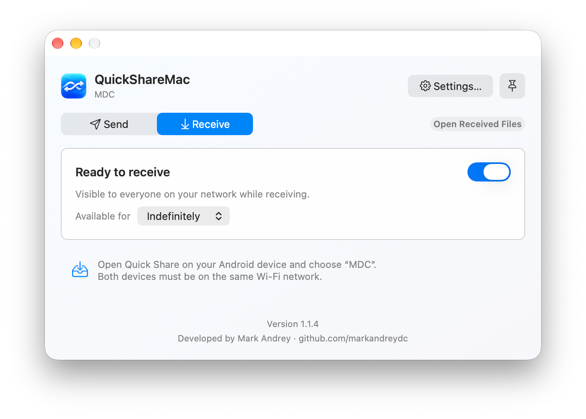
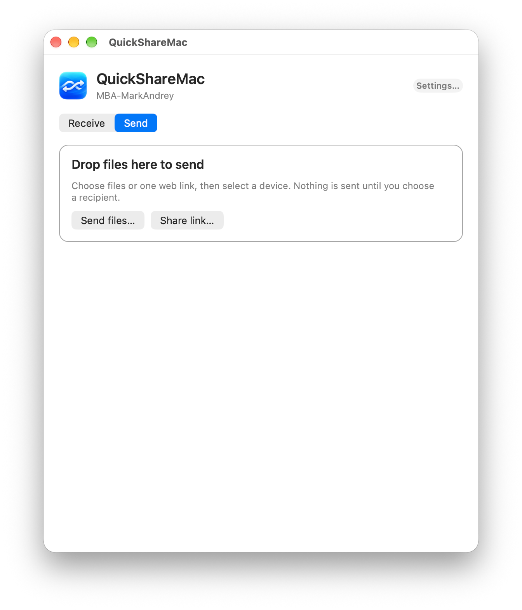
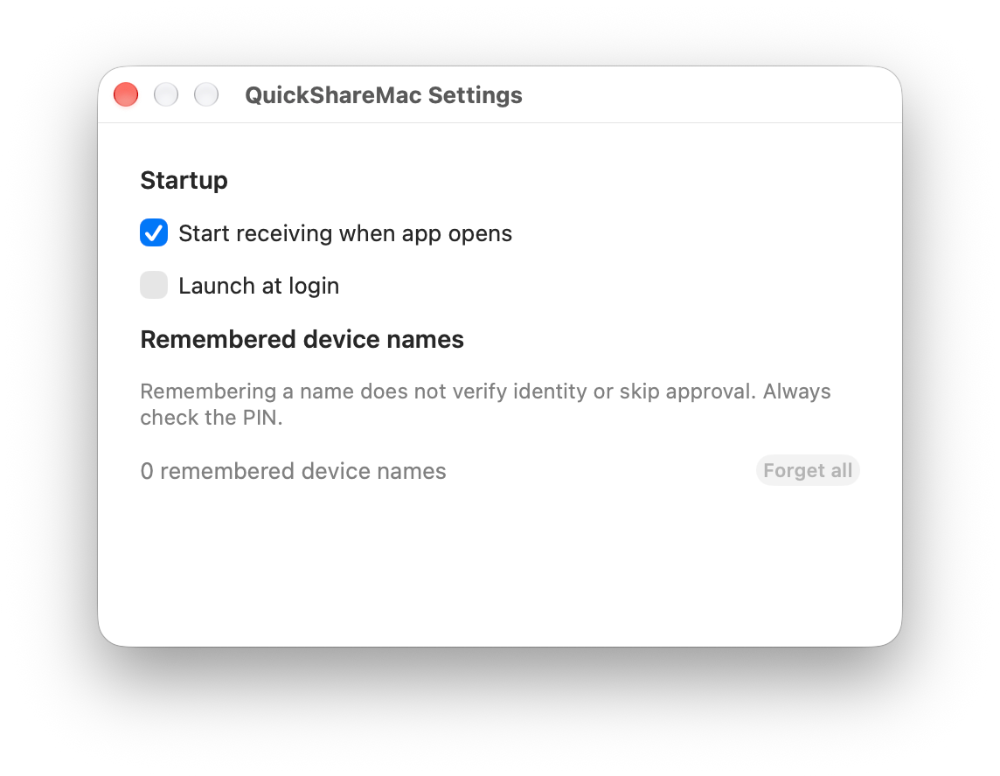

# QuickShareMac


Send files between your Mac and Android devices using **Quick Share** over your local network.

**[Download QuickShareMac for macOS](https://github.com/markandreydc/QuickShareMac/releases/latest/download/QuickShareMac.app.zip)** · macOS 12 or later · Apple Silicon and Intel

No GitHub account or coding tools needed. See [installation instructions](#installation) below.

Developed by Mark Andrey · github.com/markandreydc

**QuickShareMac is a fork of [NearDrop](https://github.com/grishka/NearDrop), created by [grishka](https://github.com/grishka).** NearDrop provides the original Quick Share/Nearby Share implementation and protocol research that this app builds on. This fork adds a dedicated Send/Receive interface, transfer history, settings, and connection diagnostics.

## Features

- **Send files and folders** from the main window, by drag-and-drop, or through Finder’s Share menu. Choose in Settings whether folders become ZIPs or their files are sent directly with folder paths.
- **Share-menu handoff:** choosing **Share → QuickShareMac** in Finder hands the selection to the main window’s Send tab instead of transferring inside the Finder sheet.
- **Receive files** with explicit approval and a PIN check for each transfer.
- **Connect with a QR code** to help your Android device become discoverable.
- View transfer progress with speed and time-remaining estimates, cancel outgoing transfers, and retry by choosing a recipient again.
- Get a notification for incoming requests instead of having the app steal focus while you work elsewhere.
- Keep recent incoming and outgoing transfer results for the current app session.
- Reveal completed downloads in Finder.
- Continue transfers in the background when switching tabs or closing the window.
- Control receiving from the main window or menu bar, and see live transfer progress there.
- Set a custom device name without renaming your Mac.
- Choose receiving availability for **10 minutes**, **30 minutes**, **1 hour**, or **Indefinitely** (the default).
- Configure launch at login, receiving on startup, and remembered device names in Settings.
- Check GitHub for updates manually, or schedule daily, weekly, or monthly checks—no automatic downloads or installation.

## Screenshots

| Receive | Send | Settings |
| --- | --- | --- |
| [](images/receive.png) | [](images/send.png) | [](images/settings.png) |

## Getting started

Both devices must be on the **same Wi-Fi/local network**. Keep your Android device unlocked while connecting.

### Send files to Android

1. Open QuickShareMac and select **Send**.
2. Click **Send files…** (the single picker accepts both files and folders) or drag files or folders onto either the Receive or Send tab. A window-wide **Drop to send** overlay previews the filename or file count and explains that you choose a nearby device next; dragging a folder shows **Compress & send**, or **Send folder** when compression is disabled. Drop to open Send and prepare items before device discovery—nothing is sent automatically. You can also use **File → Send files…** (`⌘O`).
3. Open Quick Share on your Android device and choose its receiving mode, if available.
4. Select the device in QuickShareMac, or choose **Connect with QR code…** and scan the code with your phone’s camera.
5. Check that the PIN matches on both devices, then accept on Android.

The empty Send view centers its file illustration, drop instructions, and **Send files…** button inside a dashed blue drop zone. The button stays centered when items are selected, while the item list and its count remain left-aligned.

Selections always use a compact selectable table, even for one file, folder, or shared link. Each row shows its name and icon, with alternating row colors and a persistent vertical scrollbar. The list displays up to five rows at once; scroll inside it to see the remaining items without enlarging the window. Click a row to select it, or right-click for **Open** and **Reveal in Finder**. Folder actions target the original folder, not a temporary ZIP; shared links offer only **Open**. Click the **×** at the right of a row to remove it, or **Remove All** beside the item count to clear the entire send list, without deleting anything from disk. Clearing the list restores the empty Send view and cancels pending folder preparation. These removal actions are disabled during an active outgoing transfer.

Dropping more files or folders onto either tab **adds them to the existing Send list**, preserving order and ignoring duplicate paths. Adding or removing an item during folder preparation safely restarts preparation for the remaining originals. **Send files…** and a new Share-menu handoff still replace the selection. Files cannot be mixed with a shared link: remove the link before dropping files. While an outgoing transfer is active, additions and removals are disabled until it finishes or is canceled.

Folder compression is **off by default**. You can enable **Settings → General → Sending → Compress folders into ZIP files before sending**. When enabled, each folder becomes its own ZIP—named after the folder, matching Finder’s **Compress** result—and files chosen alongside folders are sent as they are. The Send tab shows **Compressing “FolderName”…** while preparing ZIPs.

With compression off, the app shows **Gathering files from “FolderName”…**, then sends the original files with relative folder-path metadata. Folder layout depends on the receiver: receivers that ignore the paths save loose files instead. Android folder reconstruction still requires device verification. Hidden files are included, symbolic links are skipped, and empty subfolders cannot be represented; entirely empty folders show an explanation to use ZIP mode. Large folders can take a moment before discovery begins. The setting is saved, applies to the next selection, and covers the picker, drops, and **Share → QuickShareMac**; the Share extension remains a handoff adapter. An explicitly saved compression preference is kept until you change it or reset settings.

The main window starts compact and automatically adjusts its height when switching tabs, selecting items, or showing transfer requests. It stays within the screen’s usable area; longer history and overflow remain scrollable, and the filename list stays capped at five rows.

During dragging, unreadable files and unsupported content show a specific explanation instead of an accepted-drop highlight. While an outgoing transfer is active, drops are blocked until you finish or cancel it. Leaving the window or canceling the drag dismisses the overlay without changing your selection.

Alternatively, select files or folders in Finder and choose **Share → QuickShareMac**. The Share extension only hands the selection to the app: the main window comes forward with the Send tab already showing those items and device discovery running, and the transfer appears in history and the menu bar like any other send. Links can be shared the same way, such as through Safari’s Share menu; there is no link-sharing control in the main Send tab.

### Receive files on your Mac

1. Enable receiving in the **Receive** tab.
2. On Android, select files, open Quick Share, and choose your Mac’s displayed device name.
3. QuickShareMac opens the incoming request. Verify the PIN, then choose **Accept** or **Decline**.
4. Received files are saved to your chosen folder—**Downloads** by default. Use **Show in Finder** on a completed transfer to locate them, or **Open Received Files** next to the Receive/Send tabs to open the folder.

While a transfer runs, the progress row shows the percentage, bytes transferred, transfer speed, and an estimated time remaining once enough samples arrive.

Incoming requests do not steal focus. When QuickShareMac is not the active app, the request is announced with a notification—and the Dock icon bounces—instead of pulling its window to the front. Click the notification to open the approval card, then verify the PIN and choose **Accept** or **Decline**. The request waits for your decision either way. If notifications are turned off for QuickShareMac in System Settings, the window comes forward instead so a pending request is never missed. The app asks for notification permission the first time receiving is enabled.

Select **Remember this device name** before accepting if you want a visual reminder for future requests. Remembered names **do not verify identity or bypass approval**—always check the PIN. You can forget remembered names in **Settings…** (`⌘,`).

### Background behavior and settings

Closing the window does not quit the app. Click the Dock icon to reopen it, or click the menu bar icon and choose **Show QuickShareMac**. Both left-click and right-click open the standard macOS menu, with receiving controls, file sending, **Open Received Files**, Settings, and Quit. Active incoming and outgoing transfers appear in the menu with their device and percentage; an incoming request waiting for approval can be reopened from the menu, and **Cancel Transfer** cancels an outgoing transfer. While a transfer is running, the menu bar icon shows its percentage, and quitting asks for confirmation first. The icon dims while receiving is off and shows a small dot for a pending request or available update. The menu and monochrome icon follow the system appearance.

Transfer requests and history remain scrollable when the window reaches the screen’s usable height, and a new incoming request scrolls back to the top so its PIN is visible. Click the **pin icon** at the upper right to keep the main window above normal windows. A filled blue pin means **Always on top** is enabled; click it again to turn it off. The setting is remembered across launches and does not change other windows.

A small **Developed by Mark Andrey · github.com/markandreydc** credit appears at the bottom of the main window on both the Receive and Send tabs.

The menu also shows the device name and a **read-only visibility status**. “Visible to everyone on your network” describes the current receiving policy; it is not a contact-only visibility selector. When receiving is off, the menu says the device is not visible.

Use **Available for** in the Receive tab or menu to choose **10 minutes**, **30 minutes**, **1 hour**, or **Indefinitely**. The default is Indefinitely. Changing the duration while receiving starts a new timer; changing it while receiving is off only selects the duration for the next session. When the timer expires, new incoming connections stop, but active transfers can finish. Closing the window does not stop the timer, and elapsed time during sleep counts. The chosen duration is remembered; reopening the app with receiving on startup starts a fresh session.

Turning receiving off stops new incoming connections; transfers already in progress can finish. Outgoing transfers do not require receiving to be enabled.

**Settings…** is organized into **General**, **Updates**, and **About**. It matches the Send/Receive window with the unchanged logo in a compact header, icon tabs, soft backgrounds and cards, subtle borders, blue primary actions, and light/dark appearances. The header, tabs, and developer-credit footer stay fixed while longer pages scroll; the window can be resized. General contains device naming, startup options, and remembered names; Updates contains version checks and daily-check preferences; About shows the app version and upstream credits.

In **General**, choose whether receiving starts when the app opens. On macOS 13 or later, you can also enable **Launch at login**. On older systems, add the app to Login Items in System Settings.

Under **Device name** in Settings, choose **Use Mac’s name** or **Use a custom name**. The system option shows the name nearby devices will see; choosing Custom reveals an input prefilled with the current name. Click **Save changes** to apply your choice, or **Cancel** to restore the saved setting. Empty custom input shows guidance instead of a technical error, and Save stays disabled until the name is valid and changed. This changes only QuickShareMac’s identity, not your computer’s name. Discovery, receiving instructions, and outgoing handshakes use the chosen name. The Share menu extension only hands items to the app, so the app applies the name itself.

Under **Received files** in Settings, choose **Choose…** to pick any folder for incoming files—for example Desktop, Documents, or a folder of your own—or **Use Downloads** to restore the default. The Receive footer always shows the current folder, and **Open Received Files** next to the Receive/Send tabs opens it. If the chosen folder disappears, QuickShareMac falls back to Downloads.

Under **Sending**, choose whether to compress folders into ZIP files (off by default) or send their files directly with folder paths. Changes apply to your next selection, not to a preparation or transfer already running.

**Reset to defaults…** on the General page asks for confirmation before restoring the Mac’s name, Downloads destination, receiving on launch, indefinite availability, launch at login off, compression off, automatic update checks off, and default window preferences. Received files, history, remembered devices, and active transfers are kept. macOS privacy permissions are not changed.

Recent transfer results last for the current app session, until you dismiss or clear them. They are not a permanent transfer log.

### Check for updates

Choose **Check for Updates…** in the menu bar menu, the QuickShareMac application menu, or Settings. Results appear in a standalone dialog without opening Settings or changing its selected section. QuickShareMac compares its installed version with the latest stable [GitHub release](https://github.com/markandreydc/QuickShareMac/releases). It handles version tags such as `v1.0.0`, `v1.1`, and `v1` numerically, ignores build metadata, and does not offer prereleases or downgrades.

In **Settings → Updates**, use **Check for updates** to select **Daily**, **Weekly**, **Monthly**, or **Never** (the default). Checks run when due while the app is running, including after launch or wake; Monthly uses a calendar month rather than a fixed 30 days. Existing enabled daily checks remain Daily, and disabled checks become Never. Background checks show an available update in Settings and the menu without interrupting transfers with a dialog. **Check for Updates…** remains available with every schedule, including Never. Manual checks reset the schedule's last-check time; duplicate in-flight requests and GitHub rate-limit retries are suppressed. Known available updates are cached between launches.

**View Release** opens the release page in your browser. Download the ZIP yourself, let transfers finish, quit QuickShareMac, and replace the app. There is **no Sparkle dependency, automatic download, or automatic installation**. GitHub/network failures are not mistaken for “up to date.”

Update checks contact `api.github.com` using HTTPS. GitHub receives your IP address and the app version in its User-Agent, but QuickShareMac does not send files, device names, transfer history, credentials, or analytics. The checker uses no GitHub token or persistent cookies. With automatic checks off, no update request is sent until you ask for one.

For maintainers: publish a **stable GitHub Release** in `markandreydc/QuickShareMac` with a version tag such as `v1.1.0` and attach `QuickShareMac.app.zip` and its checksum. A Git tag alone is not enough. Drafts and prereleases are not offered; GitHub's `/releases/latest` endpoint determines the latest stable release.

## Installation

1. **[Download QuickShareMac](https://github.com/markandreydc/QuickShareMac/releases/latest/download/QuickShareMac.app.zip)** (ZIP file, latest version).
2. Open the downloaded ZIP file to extract **QuickShareMac.app**.
3. Drag **QuickShareMac.app** into your **Applications** folder.
4. Open **QuickShareMac** from Applications.

Requires **macOS 12 or later**, on Apple Silicon or Intel. You do not need a GitHub account, Xcode, or Terminal to install the app.

When macOS requests access, allow **Local Network** communication. You can review this under **System Settings → Privacy & Security → Local Network**.

For a build from an unidentified developer, follow [Apple’s instructions for opening an app from an unknown developer](https://support.apple.com/guide/mac-help/open-a-mac-app-from-an-unknown-developer-mh40616/mac). Local development builds are not notarized.

If macOS blocks the app after installation, you can remove its quarantine flag in Terminal. **Only do this if you trust the download**, since it bypasses the quarantine-based Gatekeeper check:

```sh
xattr -dr com.apple.quarantine "/Applications/QuickShareMac.app"
```

Then open QuickShareMac again from Applications.

If upgrading from NearDrop or an earlier build with a different app identity, review local-network permissions and Login Items again. The upstream NearDrop Homebrew package installs NearDrop, not this fork.

## Build from source

Install Xcode with its command-line tools, then run from the repository root:

```sh
Scripts/build-development.sh
```

The script builds the **QuickShareMac** Debug scheme with signing enabled and verifies the app bundle, its extension, and embedded libraries.

The app is created at:

```text
DerivedData/Build/Products/Debug/QuickShareMac.app
```

To open it:

```sh
open DerivedData/Build/Products/Debug/QuickShareMac.app
```

The default development build uses **ad-hoc signing** for local use. This is not notarization or a stable certificate-based identity. For consistent macOS permission identity across rebuilds, configure an Apple Development certificate and your team in Xcode. Do not disable code signing when building an app for device testing.

Finder’s **Share → QuickShareMac** entry belongs to the app bundle that macOS registered as *QuickShareMac*. If an older copy is installed in `/Applications`, the Share menu keeps using that copy; replace it with the new build (or remove it) when verifying changes to the Share extension.

The Share extension hands files and folders to the app through LaunchServices. Sandboxed callers may only open documents with an app that **claims** their type, so the app declares `public.item` in `CFBundleDocumentTypes`. The type uses handler rank **None**, which keeps the app out of Finder’s **Open With** menus. Removing that declaration, or narrowing it, makes the Share menu handoff fail with a “couldn’t open QuickShareMac” error even though the same open succeeds from the shell.

One handoff can also lose items if it is treated as a single open event. LaunchServices delivers one multi-file open as several events grouped by file type, and it silently drops the siblings of a quarantined download (for example a downloaded ZIP shared next to a DOCX) when the security check takes over the request. For that reason the extension opens each shared item in its own request, and the app merges open events that arrive within a couple of seconds into one Send-tab selection. Do not simplify either half back to a single batched open.

For test instructions, see [Tests/README.md](Tests/README.md). The tests cover the UI and encrypted file transfers over localhost; Android discovery and QR handshakes still need real-device testing.

### Package a release ZIP

```sh
Scripts/package-release.sh
```

This builds an optimized **universal Release app for macOS 12 or later**, supporting both Apple Silicon (`arm64`) and Intel (`x86_64`). It verifies the app and embedded code, includes the upstream/dependency licenses, and creates these files in the repository root:

- `QuickShareMac.app.zip`
- `QuickShareMac.app.zip.sha256`

The ZIP contains `QuickShareMac.app` at its top level. The packaged app is also available at `DerivedData/Distribution/Build/Products/Release/QuickShareMac.app`.

**Distribution warning:** this script uses ad-hoc signing. The app is **not Developer ID signed or notarized**, so recipients may need to approve it in Privacy & Security. For a normal Gatekeeper-approved public release, sign with your own Developer ID Application certificate and notarize/staple the app before archiving it. Do not describe the ad-hoc ZIP as notarized.

## Troubleshooting

### My phone does not appear

- Keep both devices on the same network and unlock the phone.
- Open Quick Share’s receiving screen, if available, or use **Connect with QR code…**. The QR flow is particularly useful for Samsung devices.
- This app cannot use the Android-specific Bluetooth discovery broadcasts to wake a phone into receiving mode automatically.

### Sending stays on Connecting, or the phone shows no request

A phone approval request cannot appear until the network connection and Quick Share handshake progress far enough.

- Check **Local Network** permission for QuickShareMac on your Mac.
- If it is already enabled but the app reports a policy block, fully quit (`⌘Q`) and reopen the verified, signed build before retrying.
- If the receiving device refuses the connection, reopen Quick Share on the unlocked phone and try the QR flow.
- Guest/public Wi-Fi networks can block communication between devices even when both have internet access. Check VPN, firewall, and router restrictions as well.

The app distinguishes macOS policy blocks from connection refusals and provides an **Open Network Settings…** action for local-network permission errors.

### My phone does not see my Mac

Make sure QuickShareMac is running with receiving enabled, and that both devices are on the same network. Check local-network permission and any restrictions on communication between devices.

### I closed the window, but the app is still running

This is intentional: receiving and active transfers continue in the background. Use **QuickShareMac → Quit QuickShareMac** (`⌘Q`) to quit completely.

## Limitations and privacy

- **Transfers are local network only.** Wi-Fi Direct, Bluetooth transfers, and internet relay are not implemented. Update checks optionally contact GitHub, as described above.
- **Visible on your network while receiving is enabled.** Contact-only visibility is not supported.
- **Approval is always required.** Remembered device names are not persistent, verified sender identities.
- **Folder handling is chosen in Settings.** Compression is off by default; enabling it uses `ditto` to create a ZIP per folder without modifying the original. With compression off, background enumeration sends regular files directly, carrying relative paths in both the introduction’s `parent_folder` and file payload headers. Paths are component-sanitized, same-named folder roots are disambiguated, and symbolic links are not followed. Receiver folder reconstruction is not guaranteed; the Mac receiver currently saves loose files. The same preparation applies to Finder shares, picker selections, and drops.
- **Notifications describe requests but never accept them.** The PIN check always happens in the main window.
- **Not AirDrop.** This app implements part of the Quick Share/Nearby Share protocol, not Apple’s AirDrop protocol.

[Protocol documentation](PROTOCOL.md) is available separately.

## Acknowledgements

Thank you to **[grishka](https://github.com/grishka)** and the **[NearDrop](https://github.com/grishka/NearDrop)** contributors for the original project, protocol reverse engineering, and implementation. QuickShareMac would not exist without that work.

QuickShareMac is an independently maintained fork, not an official Google, Samsung, or Apple product. Refer to NearDrop’s repository for the original upstream project.

## License

Released under the [Unlicense](UNLICENSE). See the license file for its full terms and warranty disclaimer.
